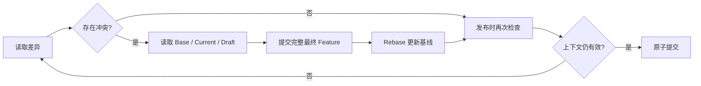

直接用草稿覆盖最新数据，会丢失其他工作区已经发布的修改。三方合并通过共同基线区分“谁改了什么”，而不是只比较当前值与草稿值是否相同。

## 三个输入

Base 是工作区基础修订的数据；Current 是最新共享数据；Draft 是工作区提交的完整最终要素。以一条道路为例：

| 属性 | Base | Current | Draft | 合并结果 |
|---|---|---|---|---|
| `name` | 滨河路 | 滨河路 | 滨河路 | 滨河路 |
| `level` | 2 | 3 | 2 | 3，保留他人的修改 |
| `width` | 12 | 12 | 15 | 15，接受草稿修改 |

两侧改变不同属性时可以自动合并。如果两侧把同一字段分别改为不同值，则需要显式解决。删除与修改相遇时，也不能仅凭“最后请求到达”决定结果。

## 几何为什么整体比较

几何包含有序坐标、维度与空间语义。当前实现把它作为整体合并单元，不对顶点执行自动拼接，也不自动保证跨要素拓扑一致。

两个用户分别移动同一条线上的不同节点，并不意味着组合后的线必然满足业务约束。系统将冲突呈现给使用者，最终几何由完整 Feature 明确表达。

## 冲突处理循环

Resolve 请求携带当前 HEAD 和工作区版本，解决选择只对这个上下文有效。共享版本或草稿再次变化后，原选择可能标记为 `stale_resolution`，需要重新确认。

## 与字段结构变更分开处理

普通属性值按三方规则合并；字段增删影响 Schema 与潜在的整张数据集，因此采用更保守的 HEAD 校验。不能把普通字段值自动合并的行为推广为任意数据库 DDL 自动合并。

## 操作入口

独立属性自动合并可以减少人工选择，整体几何比较则把最终空间结果交给审阅者。自动合并不承诺跨要素拓扑正确性。保存解决结果、更新基准和发布的步骤见[工作区指南]()。

## 实现依据

- [crates/core/src/merge.rs](https://github.com/mapseekai/geoledger/blob/5bf353c88cb017c8c00035fb86667dd2d7497b43/crates/core/src/merge.rs)
- [crates/engine/src/publication.rs](https://github.com/mapseekai/geoledger/blob/5bf353c88cb017c8c00035fb86667dd2d7497b43/crates/engine/src/publication.rs)
- [docs/storage.md](https://github.com/mapseekai/geoledger/blob/5bf353c88cb017c8c00035fb86667dd2d7497b43/docs/storage.md)
