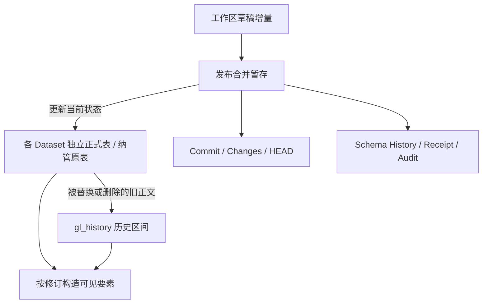

存储格式 19 的核心取舍是：当前数据放在独立正式表中，草稿与历史独立管理；历史仅归档需要保留的旧正文，而不是在每次发布时复制全量数据。

## 三种数据状态

图中发布涉及的写入属于同一数据库事务。箭头描述数据关系，不代表后台异步复制流水线。

## 自建数据集

创建数据集时立即创建 `gl_data_<随机标识>` 正式表与空间索引，即使数据集尚无要素。`gl_datasets.storage_table` 维护逻辑数据集与物理表的映射；显示名称改变不重建表身份。

每行通过 `feature_id` 定位，属性以精确 JSON 保留，`geometry_json` 保存原始几何表达。原生几何列服务于空间查询，两者承担不同职责。

## SQLite 与 PostGIS

| 方面 | SQLite + SpatiaLite | PostgreSQL + PostGIS |
|---|---|---|
| 空间表示 | SpatiaLite XY / XYZ 几何列 | 原生 geometry 列 |
| 空间索引 | RTree 候选 + 精确相交判断 | GiST 与原生几何查询 |
| 并发协调 | WAL，写事务 BEGIN IMMEDIATE | 连接池、项目与工作区锁 |
| 一致读取 | 事务快照 | 读事务 REPEATABLE READ |

自建数据集的派生索引使用 SRID 0，坐标含义来自数据集 CRS；这不是把数据自动转换成 WGS 84。已有 PostGIS 原表写回保留源表 SRID。

## 当前数据与旧正文

当前查询走正式表或纳管原表。历史查询按有效期将当前行与 `gl_history` 中被替换、删除的旧正文组合。提交明细保存要素身份与增删标记，历史正文承担状态重建。

对于大数据集，成本来自实际受影响要素、历史索引、空间选择性和事务锁范围，不能仅凭“增量存储”就推导出常量时间发布或任意规模性能。

## 后端扩展的最低要求

自定义后端需要提供一致快照、原子发布、删除遮蔽、精确 JSON、幂等回执、审计顺序、页级游标和期限传播等语义，并通过同一 conformance 套件。只实现一个 CRUD 接口并不足以成为兼容的版本后端。

## 存储与恢复的关系

增量和历史布局减少重复保存完整快照的需要，但保留策略仍须覆盖历史、草稿与审计的增长。备份与逻辑导出承担不同恢复边界，具体工具见[备份指南]()。

## 实现依据

- [crates/engine/src/repository.rs](https://github.com/mapseekai/geoledger/blob/5bf353c88cb017c8c00035fb86667dd2d7497b43/crates/engine/src/repository.rs)
- [crates/engine/src/session/query.rs](https://github.com/mapseekai/geoledger/blob/5bf353c88cb017c8c00035fb86667dd2d7497b43/crates/engine/src/session/query.rs)
- [crates/engine/tests/conformance.rs](https://github.com/mapseekai/geoledger/blob/5bf353c88cb017c8c00035fb86667dd2d7497b43/crates/engine/tests/conformance.rs)
- [docs/storage.md](https://github.com/mapseekai/geoledger/blob/5bf353c88cb017c8c00035fb86667dd2d7497b43/docs/storage.md)
