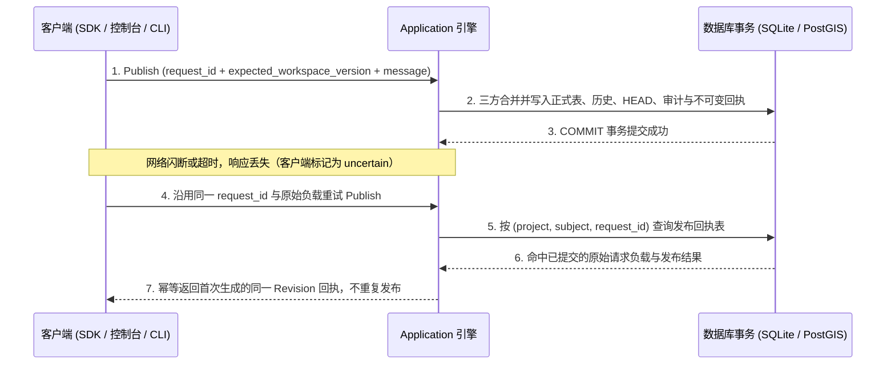

在版本化空间数据服务中，一次“发布（Publish）”操作远不止是向数据表插入几行记录——它需要同时更新多张数据集正式表（或外部 PostGIS 业务表）、归档被覆盖的历史旧正文、执行版本化字段 DDL、记录提交明细与字段历史、推进项目 `HEAD`、更新工作区状态、写入幂等发布回执并追加审计日志。

如果这些步骤分散在多个独立事务中执行，一旦中途发生进程崩溃或约束冲突，数据库就会陷入“正式表已更新但历史记录缺失”或“审计已写入但发布实际失败”的半成品状态。GeoLedger 通过**单一事务所有者模式**与**事务内不可变回执**彻底消除了此类不一致风险。

## 1. 单一事务所有者模式（Single Transaction Owner）

在 `geoledger-engine` 中，每一次业务 API 调用都严格对应一个 `RepositoryTransaction` 生命周期：

1. **统一开启与预算绑定**：`Application` 从存储后端获取事务对象，并将当前请求的截止时间（Deadline）与响应编码字节预算（`ResponseBudget`）绑定到该事务。
2. **按能力可变借用（`t.as_mut()`）**：执行权限校验、草稿保存、三方合并或历史写入的子模块仅借用事务对象的特定能力接口（如 `WorkspaceRepository` 或 `PublicationRepository`）。这些子接口**不包含 `commit` 方法**，因此任何内部函数都无法私自提前提交事务，也不会另起炉灶开启第二个数据库连接。
3. **先完成编码校验，再执行唯一提交**：在事务即将结束前，`Application` 会先完成响应结构的组装与字节预算检查；只有当所有业务规则、数据库约束（包括 PostGIS 纳管表的延迟约束与触发器核对）和内存预算全部通过后，事务所有者才会调用消耗所有权的 `commit(self: Box<Self>)`。
4. **失败清理与事务原子性**：未提交的事务在清理时回滚暂存修改；SQLite 会尝试执行 `ROLLBACK`，PostGIS 在超时或 panic 等情况下会隔离失效连接，直到确认后端清理。数据库负责保证事务不会部分提交；如果提交结果未知，客户端须使用原发布意图确认，而不能仅凭超时认定回滚。

## 2. 并发协调：项目锁、工作区锁与连接池安全

当多个用户或自动化脚本并发操作时，GeoLedger 在细粒度锁上协调读写冲突：

- **同工作区写入串行化**：针对同一个工作区的 `save`、`resolve`、`rebase`、`discard` 与 `publish` 会获取该工作区的写锁（`workspace_state(write=true)`），并核对 `expected_workspace_version`，确保同一份草稿不会被并发请求交错覆盖。
- **同项目发布串行化**：针对同一项目的并发 `publish`（以及构建冲突缓存的 `conflicts`）会获取项目级 `HEAD` 锁（`project_head(lock=true)`），并在获锁后读取最新的 `HEAD` 修订号执行三方合并检验。不同项目不共享该项目锁，但仍受数据库和连接池等共享资源限制；SQLite 使用 `BEGIN IMMEDIATE`，不同项目的写事务也会串行化。
- **独立审计顺序锁**：在 PostgreSQL / PostGIS 下，追加项目审计日志（`append_audit`）在分配自增序号前会获取项目级事务咨询锁（Advisory Lock），保证审计事件的 ID 顺序与事务实际提交顺序严格一致，从而让基于 `id > after` 的审计游标分页永不遗漏并发提交的事件。
- **PostGIS 连接池的安全回收**：当某个 PostgreSQL 请求因超时或取消而中断时，如果后端会话已确认完成 `ROLLBACK` 清理，连接池会直接复用该健康连接；若回滚状态不确定或连接发生协议错误，连接池会安全淘汰该连接并在确认原后端会话消失前保留池名额，防止失控的慢查询耗尽数据库资源。

## 3. 网络断连与响应丢失下的幂等发布恢复

最棘手的分布式边界情况发生在 **`COMMIT` 成功之后、客户端收到响应之前**：此时数据库已经完成了版本发布，但因网络闪断或网关超时，客户端只收到了连接断开或 `504` 错误。

GeoLedger 通过将**发布回执**（Publication Receipt）纳入同一个发布事务来解决这一问题：

### 幂等回执的安全校验规则

- **复合唯一键**：回执表（`gl_idempotency`）以 `(project, subject, request_id)` 为主键，记录首次提交时的序列化请求负载（`payload`）与返回结果（`result`）。
- **防篡改负载比对**：当客户端使用相同的 `request_id` 重试时，服务端不仅检查该 ID 是否存在，还会严格比对本次请求的 `(workspace, expected_workspace_version, message)` 是否与已记录的 `payload` 完全一致。若完全一致则直接返回原 `result`；若不一致则立即返回 `409 Conflict (request_id payload mismatch)`，防止调用方误将旧 UUID 复用给新的发布任务。
- **客户端实操指南**：关于如何在四语言 SDK、CLI 与控制台中持久化并重放发布意图，请参阅操作手册中的 **[确认与恢复中断的发布]()**。

## 实现依据

- [crates/engine/src/lib.rs](https://github.com/mapseekai/geoledger/blob/9d31fb5f1e3547ba940518564105cb4a13ea42df/crates/engine/src/lib.rs)
- [crates/engine/src/publication.rs](https://github.com/mapseekai/geoledger/blob/9d31fb5f1e3547ba940518564105cb4a13ea42df/crates/engine/src/publication.rs)
- [crates/engine/src/repository.rs](https://github.com/mapseekai/geoledger/blob/9d31fb5f1e3547ba940518564105cb4a13ea42df/crates/engine/src/repository.rs)
- [docs/storage.md](https://github.com/mapseekai/geoledger/blob/9d31fb5f1e3547ba940518564105cb4a13ea42df/docs/storage.md)
