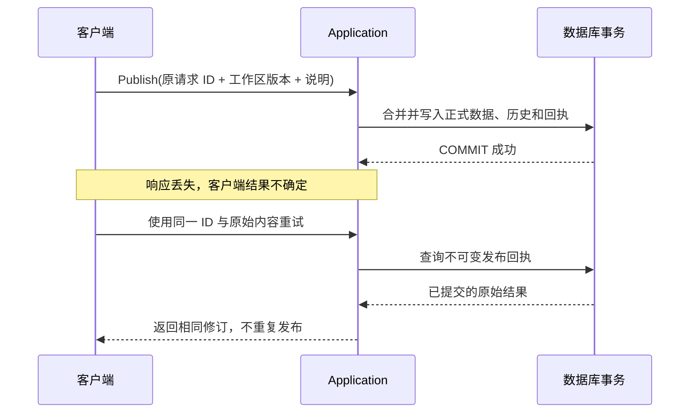

一次发布的正确性不只取决于“正式表写入成功”。当前要素、旧正文、提交明细、字段历史、HEAD、工作区状态、幂等回执和审计必须具有相同的提交结果。

## 单一事务所有者

Application 开启事务，执行授权与校验、调用合并、完成响应编码和预算检查，再唯一一次提交。存储能力可以拆分为多个 trait，但它们共享连接、快照、锁、期限和暂存状态。

领域函数借用所需能力，不能提前提交，也不能另开连接把审计或回执写入另一个事务。事务未提交即被丢弃时，后端必须回滚全部写入。

## 并发发布如何协调

同项目发布在项目 HEAD 锁上协调，获得锁后读取最新 HEAD。工作区写入在自身状态锁上协调，并检查预期编辑版本。这样既保护共享版本推进，也避免同一草稿被多个请求无意覆盖。

锁与请求都受总期限约束。PostGIS 连接发生取消或故障时，确认回滚前仍可能占用连接池名额；不能把“调用已超时”简单等同于“数据库已停止工作”。

## 响应丢失的情况

回执键为 `(project, subject, request_id)`。相同 ID 配不同请求内容会被拒绝，避免一次身份对应两种发布意图。

## 客户端需要保存什么

客户端保存完整发布意图，并将结果未知与明确拒绝分开处理。句柄重试、跨进程持久化、身份恢复和结果核对统一见[确认与恢复发布]()。

## 成本与测量边界

发布 RPC 耗时与完整“保存多批、审阅和发布”流程耗时不同。任何性能报告都应注明版本、后端、数据量、索引、并发和测量范围；本页描述一致性机制，不给出未经当前环境验证的性能承诺。

## 实现依据

- [crates/engine/src/lib.rs](https://github.com/mapseekai/geoledger/blob/5bf353c88cb017c8c00035fb86667dd2d7497b43/crates/engine/src/lib.rs)
- [crates/engine/src/publication.rs](https://github.com/mapseekai/geoledger/blob/5bf353c88cb017c8c00035fb86667dd2d7497b43/crates/engine/src/publication.rs)
- [crates/engine/src/repository.rs](https://github.com/mapseekai/geoledger/blob/5bf353c88cb017c8c00035fb86667dd2d7497b43/crates/engine/src/repository.rs)
- [docs/storage.md](https://github.com/mapseekai/geoledger/blob/5bf353c88cb017c8c00035fb86667dd2d7497b43/docs/storage.md)
