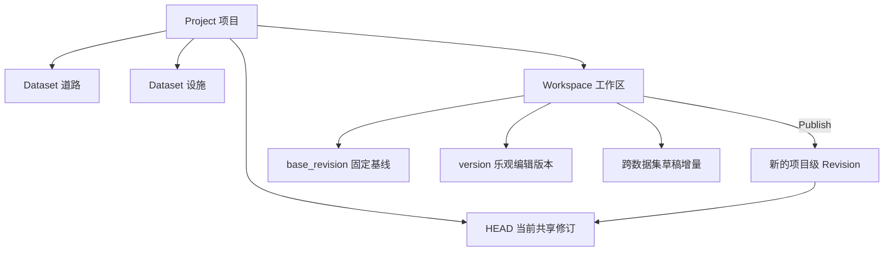

版本模型需要回答两个问题：本次修改以什么状态为基础，以及一次查询能看见什么状态。GeoLedger 将共享数据修订与工作区编辑版本分开表示。

## 对象关系



Project 统一分配共享修订。多个数据集的修改可以在一个工作区中准备，最终进入同一事务和同一个修订。

## 开放工作区读取

开放工作区的可见状态等于基础修订叠加本工作区增量。增量包括新增、修改和删除；如果某条草稿恢复为基线值，可以移除相应 delta。

工作区不是完整数据集副本，也不是永远跟随项目 HEAD 的视图。其他人的发布不会悄悄改变你的基础修订。

## 发布后的工作区读取

发布成功后，工作区状态为已发布，读取固定在自己的发布修订。它仍保留基础修订，用于说明差异和发布来源；基础修订与发布修订是不同概念。

草稿正文可以被清理，工作区摘要与差异从提交和版本记录重建。空提交也需要保留准确的发布修订身份。

## 历史区间

历史正文的可见性满足：

```text
valid_from <= revision
AND (valid_to IS NULL OR revision < valid_to)
```

当前行与旧历史按照这个区间共同构造过去的数据。删除保留历史墓碑，不能把“当前行不存在”直接理解为“这个要素从未存在”。

## 保持身份稳定

Feature ID 标识要素，Dataset ID 标识数据集，Project ID 标识项目。显示名称变化不应改变物理表身份或要素身份。项目 HEAD 是已分配修订的高水位；生命周期清理后可能有空缺，不重新编号或复用历史修订号。

## 读取取舍

固定基线使开放草稿可重现，也意味着编辑者需要显式处理 HEAD 推进。已发布工作区固定在自己的发布修订，适合核对当次结果；持续获取最新数据时应查询正式 HEAD。实际扫描规则见[分页参考]()。

## 实现依据

- [crates/engine/src/workspace.rs](https://github.com/mapseekai/geoledger/blob/5bf353c88cb017c8c00035fb86667dd2d7497b43/crates/engine/src/workspace.rs)
- [crates/engine/src/query.rs](https://github.com/mapseekai/geoledger/blob/5bf353c88cb017c8c00035fb86667dd2d7497b43/crates/engine/src/query.rs)
- [crates/engine/src/session/history.rs](https://github.com/mapseekai/geoledger/blob/5bf353c88cb017c8c00035fb86667dd2d7497b43/crates/engine/src/session/history.rs)
