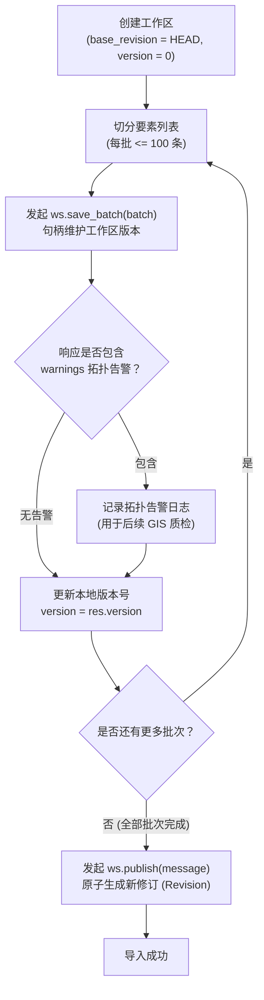

在 GIS 数据迁移、历史图层初始化或第三方测绘数据接入等场景中，用户往往需要向 GeoLedger 写入成千上万条乃至数十万条空间要素。

理解 GeoLedger 的批次模型与版本控制机制，是编写高效、高可靠导入脚本的关键：
- **批次有界（1~100 条/批）**：单次 `save` 请求最大支持修改或添加 100 条要素（超出将返回 `400 Bad Request`）。
- **分批累积草稿**：可以连续向同一工作区保存多个批次；总规模仍受存储空间、内存和发布耗时等实际条件约束。
- **单次原子发布（Atomic Commit）**：所有分批保存的草稿均暂存在工作区版本表中，全部批次写入完毕后只需调用一次 `publish`，即可在**同一个数据库事务**内将全量要素发布为一个全新的全局修订号（Revision）。

---

## 批量导入核心机制与设计原则



### 1. 批次大小与网络预算（Chunking）

- **建议批次大小**：每批最多 **100 条要素**；大型几何可进一步缩小批次，并结合实际编码大小和服务端限制调整。
- **传输上限**：GeoLedger 服务端单次请求最大受限为 64 MiB（环境变量 `GL_MAX_REQUEST_BYTES`，默认 64 MiB）。如果要素包含极为复杂的超长多边形环（如精细海岸线），可适当缩减单批条数（如 10~20 条/批），确保请求不超出服务端内存预算。

### 2. 严格按工作区版本递增（Optimistic Versioning）

工作区在创建时初始版本号 `version` 为 `0`。每次调用 `save` 时：
1. 客户端在请求中携带 `expected_workspace_version`；
2. 服务端核对该版本号与数据库中当前工作区版本一致后，写入本批要素并将版本号递增（`version + 1`）；
3. 客户端必须在下一次 `save` 时传入新返回的 `version`。如果因网络丢包或并发修改导致版本号落后，服务端会返回 `409 Conflict` 阻断写覆盖。

### 3. 拓扑告警（Topology Warnings）处理

GeoLedger 在保存几何时校验坐标结构、环闭合与几何类型，并对拓扑有效性进行诊断。
- 对于自相交等拓扑诊断，服务端保留原始几何并在响应中返回 `warnings`；结构或其他必需校验失败时仍会拒绝整批保存。
- 批处理脚本应当收集或打印这些警告日志，以便数据治理团队进行后续空间拓扑修复。

---

## 批量导入示例（Python SDK）

以下函数接收已有工作区、数据集 ID 和完整 GeoJSON Feature 列表，按每批最多 100 条保存后发布。调用方保留 `workspace` 句柄，以便在发布结果不确定时恢复原请求。

```python
import sys
from typing import Any

from geoledger import Edit, Workspace

BATCH_SIZE = 100

def batch_import_features(
    workspace: Workspace,
    dataset_id: str,
    features: list[dict[str, Any]],
    publish_message: str,
) -> int:
    """保存完整 GeoJSON Feature，并返回发布修订号。"""
    if not features:
        raise ValueError("要素列表不能为空")

    total = len(features)
    for start in range(0, total, BATCH_SIZE):
        chunk = features[start : start + BATCH_SIZE]
        edits = [Edit(dataset_id, feature["id"], feature) for feature in chunk]
        reply = workspace.save_batch(edits)
        for warning in reply["warnings"]:
            print(warning, file=sys.stderr)
        print(f"已保存 {start + len(chunk)}/{total}，工作区版本 {workspace.info.version}")

    receipt = workspace.publish(publish_message)
    return receipt["revision"]
```

---

## 批量导入示例（Go SDK）

Go 的 `Edit.Feature` 接收编码后的完整 GeoJSON。下面的函数使用已有工作区句柄，逐批保存并发布：

```go
package main

import (
	"context"
	"encoding/json"
	"fmt"
	"log"

	"github.com/mapseekai/geoledger/sdk/go"
)

const batchSize = 100

func ImportFeatures(
	ctx context.Context,
	ws *geoledger.Workspace,
	datasetID string,
	features []geoledger.Feature,
	commitMessage string,
) (int64, error) {
	if len(features) == 0 {
		return 0, fmt.Errorf("要素列表不能为空")
	}

	total := len(features)
	for i := 0; i < total; i += batchSize {
		end := i + batchSize
		if end > total {
			end = total
		}
		edits := make([]geoledger.Edit, 0, end-i)
		for _, feature := range features[i:end] {
			raw, err := json.Marshal(feature)
			if err != nil {
				return 0, fmt.Errorf("编码要素 %s 失败: %w", feature.ID, err)
			}
			edits = append(edits, geoledger.Edit{
				Dataset:   datasetID,
				FeatureID: feature.ID,
				Feature:   raw,
			})
		}

		reply, err := ws.SaveBatch(ctx, edits)
		if err != nil {
			return 0, fmt.Errorf("保存批次 [%d-%d] 失败: %w", i, end, err)
		}

		if len(reply.Warnings) > 0 {
			log.Printf("批次 [%d-%d] 包含 %d 条拓扑告警", i, end, len(reply.Warnings))
		}
	}

	receipt, err := ws.Publish(ctx, commitMessage)
	if err != nil {
		return 0, fmt.Errorf("发布工作区失败: %w", err)
	}

	log.Printf("批量导入完成，修订号 r%d，状态 %s", receipt.Revision, receipt.Status)
	return receipt.Revision, nil
}
```

---

## 性能调优与故障应对清单

| 场景 / 问题 | 诊断原因 | 推荐解决策略 |
|---|---|---|
| **报 `400 Bad Request: bad parameter`** | 单次 `save` 提交的要素数超过了 100 条，或者同批中出现了相同的 `(dataset, feature_id)` | 保证切片 `len(edits) <= 100`，并在客户端去重，确保同批次内 ID 唯一 |
| **报 `413 Payload Too Large`** | 单次请求体积超过了服务端的 `GL_MAX_REQUEST_BYTES`（默认 64 MiB） | 缩减每批要素数量；或调高服务端的 `GL_MAX_REQUEST_BYTES` 与 `GL_REQUEST_MEMORY_BYTES` |
| **报 `409 Conflict: workspace version mismatch`** | 并发调用或重试时未正确更新 `expected_workspace_version` | 确保每次 `save` 严格串行执行，下一批必须使用上一批返回的递增版本号 |
| **大量复杂多边形导入耗时较长** | 几何大小、数据库负载和业务表索引等都会影响耗时 | 在独立环境测量并调整批次大小，检查数据库资源与索引开销 |
| **发布时报三方冲突（`409 Conflict`）** | 在批次保存期间，主线 `HEAD` 已被其他协作者发布了新的提交 | 获取最新 `HEAD`，按 **[工作区编辑与冲突解决]()** 指南审阅冲突并变基 |

保存响应丢失时，先刷新工作区并检查草稿，再决定如何继续。发布结果不确定时保留原工作区句柄和发布意图，按 **[发布结果恢复]()** 处理。

## 实现依据

- [crates/engine/src/workspace.rs](https://github.com/mapseekai/geoledger/blob/5bf353c88cb017c8c00035fb86667dd2d7497b43/crates/engine/src/workspace.rs)
- [crates/server/src/limits.rs](https://github.com/mapseekai/geoledger/blob/5bf353c88cb017c8c00035fb86667dd2d7497b43/crates/server/src/limits.rs)
- [proto/geoledger/v1/geoledger.proto](https://github.com/mapseekai/geoledger/blob/5bf353c88cb017c8c00035fb86667dd2d7497b43/proto/geoledger/v1/geoledger.proto)
- [sdk/python/geoledger/__init__.py](https://github.com/mapseekai/geoledger/blob/5bf353c88cb017c8c00035fb86667dd2d7497b43/sdk/python/geoledger/__init__.py)
- [sdk/go/workspace.go](https://github.com/mapseekai/geoledger/blob/5bf353c88cb017c8c00035fb86667dd2d7497b43/sdk/go/workspace.go)
- [docs/performance.md](https://github.com/mapseekai/geoledger/blob/5bf353c88cb017c8c00035fb86667dd2d7497b43/docs/performance.md)
